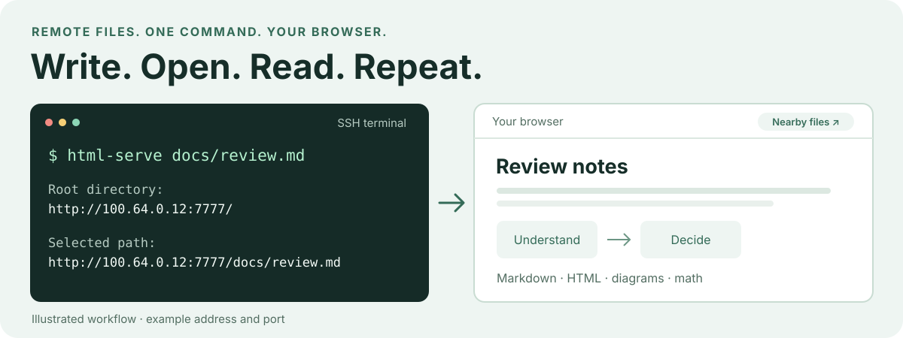

# html-serve

**English** · [한국어](README.ko.md) · [Command reference](docs/guide.md)

> AI writes the docs. Get back to reading them.

Open HTML and Markdown from your SSH server with one command. Get a memorable
free port, links for your network, and the surrounding files to explore.



## Why I built this

AI agents kept creating documents I actually wanted to read: explanations,
design notes, plans, and diagrams in Markdown and HTML.

But most of my work happens on a remote SSH server. Every new document meant
finding the file, starting a server, choosing a port, and figuring out which
address to open. Across different sessions and projects, that small chore kept
coming back.

My workflow was already a loop: **create a document → serve it → read it → repeat.**
I wanted a small command and a simple agent skill to make that loop easy.

So I built `html-serve`. In my setup, the skill gives me a command after the
agent creates a document. I run it in the SSH terminal, open the printed link
on my computer, and read.

## Give it a file. Keep the context.

```sh
html-serve docs/review.md
```

Example links with Tailscale available. Your address and free port will vary:

```text
Root directory:
- http://100.64.0.12:7777/ — Tailscale

Selected path:
- http://100.64.0.12:7777/docs/review.md — Tailscale
```

Open the document directly, or use the root listing to browse nearby files.
Keep the command running while you read. Press **Ctrl+C** when you finish.
Your computer needs a network route to the printed address, such as a shared
LAN or VPN.

The useful part is what you can leave to the command:

- **A port you can remember.** It tries free ports such as `7777`, `8888`, and
  `9999`, skips occupied ports, and keeps the chosen port reserved. Concurrent
  sessions get different ports.
- **The project around the file.** Pass a file or directory, and it detects the
  enclosing Git repository root. Browse related notes and keep relative links
  and assets accessible. Outside Git, it uses the directory or the file's parent.
- **Addresses you can use.** It detects active Tailscale, VPN, and LAN IPv4
  addresses and prints links to both the root and your selected document.
- **Documents ready to read.** HTML opens as HTML. Markdown renders with tables,
  Mermaid diagrams, math, SVG images, and a light/dark toggle. The renderer and
  fonts ship with the tool, so the preview needs no CDN.

Nearby files appear in a directory listing, with clickable **Title**,
**Created**, and **Modified** headers. Open another document from there without
returning to the terminal.

## Start on your SSH server

Install [uv](https://docs.astral.sh/uv/) and
[just](https://github.com/casey/just), then run:

```sh
git clone https://github.com/vimkim/html-serve.git ~/gh/html-serve
cd ~/gh/html-serve
just sync
```

Serving requires **Python 3.10+** and Linux **iproute2** (`ip`). The Python
runtime has no third-party dependencies. Node/npm are for development only.

```sh
html-serve                     # Browse the current directory
html-serve docs/review.md      # Read Markdown, with its Git project as the root
html-serve output/report.html  # Open HTML with its surrounding assets
```

Run the command in your SSH terminal, then open a printed URL in your computer's
browser. The command stays in the foreground. In my workflow, an agent skill
suggests the command. You can also run it directly.

## Read more

The detailed documentation lives in [`docs/`](docs/guide.md):

- [Paths, Git roots, and directory browsing](docs/guide.md#paths-and-file-selection)
- [Markdown, Mermaid, math, and themes](docs/guide.md#markdown-preview)
- [Ports, network addresses, and server options](docs/guide.md#server-options)
- [Development, tests, and bundled assets](docs/guide.md#source-and-installation)
