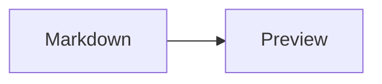

# docserve guide

[English overview](../README.md) · [한국어 소개](../README.ko.md)

This guide contains the command reference and development details.
See the [development-only security notice](../README.md#docserve) before serving files.

Run `docserve` in an SSH terminal from the directory you want to serve:

```sh
docserve
docserve .
docserve '/another/output directory'
docserve path/to/review.html
docserve README.md
docserve -d '/another/output directory' -f review.html
docserve --port 8080
```

Installation adds `docserve`, `html-serve`, and `md-serve` to PATH. All three
commands use the same server and accept the same arguments. The aliases support
both HTML and Markdown.

Directory URLs always show a listing, even when `index.html` or `index.htm` exists. Click
the filename to open that page, or select it explicitly on the command line.

## Directory listing

Listings show clickable **Title**, **Created**, and **Modified** column headers.
Select a header to sort by that column; select it again to reverse direction.
Title starts A–Z; either date starts newest first. An arrow marks the active
column and direction. The initial order is Modified, newest first. There are
no separate sorting buttons.

Title sorts by filename, including its extension, using Unicode
case-insensitive character order with case-sensitive ties. Digits sort as
characters (`report10` before `report2`). Date ties sort alphabetically, and
unavailable dates stay last in either direction. Files and directories share
the order, with `../` always first when inside the serving root.

Sorting works without JavaScript and is recorded in the directory URL:
`?sort=title`, `?sort=created`, or `?sort=modified`. Add `&order=asc` or
`&order=desc` to choose direction; a missing or invalid direction uses that
column's initial direction. Parent and child directory links retain both
settings. A bare directory URL starts newest modification first. File links
retain their normal URLs; browser Back returns to the sorted listing.
The document toolbar's **Directory listing** button opens the directory pane;
**Full directory listing** in that pane opens the normal listing in default order.

**Copy path** beside an entry copies its absolute server filesystem path.
**Copy path** next to **Go to root** copies the listed directory's path.
Copy buttons are also available beside entries in the document's directory
pane and in the finder preview for the selected file. Paths keep the visible
symlink name and are copied without shell quoting.

Dates use the server's local timezone; hover over a date for its ISO timestamp
and UTC offset. Directory dates describe the directory itself, not its newest
descendant. Symlink dates follow the target while the visible name retains `@`;
dangling links remain listed with unavailable dates.

**Created** means the filesystem object's birth date, which can change when
files are copied or checked out. It is **Unavailable** when the filesystem
does not supply it. On Linux, optional GNU Coreutils `stat` supplies birth dates
in bounded batches; missing tools, unsupported filesystems, or lookup timeouts
leave the listing usable. Metadata-change time is never substituted for birth
time. Add `--verbose` to see lookup diagnostics.

## Finding and revisiting paths

The directory listing has **Find files**, **Find contents**, **Find directories**,
**Recently visited**, and **Recently updated** buttons. Each opens the same finder screen.
**Go to root** opens the serving root listing. This is the directory selected
by the CLI, which can be the enclosing Git repository root.

File and directory queries use fuzzy matching against relative paths.
For example, `docsrev` can match `docs/design-review.md`.
Click a result to select it and preview it on the right. Markdown and HTML
render by default. Use **View → Source** to inspect their original text;
other text files show source directly.
Use the arrow keys to select another result. Press Enter or click **Open file**
or **Open directory** to navigate. Escape closes the finder and returns focus
to its button. The preview appears below the results on narrow screens.

Search covers the serving root by default. Select **Current directory** to
search the current directory and its descendants. File, directory, and content
search use `fd` (or `fdfind`) to enumerate paths. Install fd on the server to use
these searches; ordinary browsing and previews work without it. Searches use
fd's native `.gitignore`, `.ignore`, and `.fdignore` handling, including ancestor
and global ignore files. They do not read `.rgignore`. Hidden and ignored
entries stay out of results unless **Include hidden and ignored** is selected.
Git's `.git` internals always stay excluded. These filters do not change the
ordinary directory listing. Empty directories are searchable.
Search skips symlinked directories and symlinked files whose targets leave
the serving root. Ordinary direct links retain their existing behavior.

When file, directory, or content search starts at the filesystem root `/`,
the packaged [docserve.ignore](../src/html_serve/docserve.ignore) file adds
explicit exclusions for `/var`, `/usr`, `/proc`, `/sys`, and `/dev`.
This file uses gitignore-style patterns and is passed directly to fd.
Edit it to maintain the root-search exclusions, then reinstall with `just sync`
after merging source changes. These rules still apply with **Include hidden
and ignored**. They apply only to searches starting at `/`: a **Current directory**
search inside `/usr`, for example, can still search that directory. Names such
as `/home/project/usr` remain searchable. Direct browsing is unaffected.

**Find contents** requires the `rg` (ripgrep) executable on the server.
The finder explains when it is unavailable. File and directory finding and
normal viewing still work without it. Content queries use literal text and
smart case: lowercase queries ignore case, while queries with uppercase
characters are case-sensitive. Select **Regex** for regular expressions.
Results include matching line numbers. Select **View → Source** to highlight the
selected match in Markdown or HTML; other text previews highlight it directly.
Opening a result uses its normal viewer, including rendered Markdown.

Use **Include filenames (regex)** to search only matching filenames and
**Exclude filenames (regex)** to skip matching filenames. Both are optional
and match the filename, including its extension, rather than directory names.
For example, include `\.md$` for Markdown files or `\.(md|txt)$` for Markdown
and text files; exclude `^draft` to skip names starting with `draft`.
These filters always use ripgrep regular expressions, independently of the
content **Regex** checkbox, and use the same smart-case behavior. Exclusion
takes precedence. Invalid patterns show an error. Filename filtering shares
the content search's execution budget. The same filename filters are available
in **Recently updated**, with separate values for each mode.

**Recently updated** recursively lists files by modification time, newest first,
regardless of visit history. It starts at the serving root, with
**Include filenames (regex)** set to `\.(html|md)$` to show only `.html` and `.md`
files, including uppercase extensions. Clear that field to include all file
types, or edit it and **Exclude filenames (regex)** to choose other filenames.
Type a fuzzy path query to narrow the results while keeping modification order.
Equal modification times sort by descending path bytes, as in `recent-docs.sh`.
Results show modification times and use the same preview and open controls as file search.
While a search is running, the finder shows an animated progress indicator and
elapsed time. Recently updated also explains that it is scanning files and
checking modification times. The indicator does not estimate a percentage.
**Current directory** includes its descendants. Recently updated follows
`recent-docs.sh` filtering rules: it uses `fd`'s native `.gitignore`, `.ignore`,
and `.fdignore` handling, including ancestor and global ignore files.
It does not read `.rgignore`. Hidden and ignored entries stay excluded unless
**Include hidden and ignored** is selected. `node_modules`, Git internals,
and all symlinks stay excluded even with that option.
The default `.html`/`.md` filter and an empty filter work without `rg`.
Other filename regexes require `rg`.

Recently updated scans the complete scope before selecting the newest 200 files.
It uses `fd` or `fdfind` for native parallel scanning and ignore filtering.
Otherwise, it requires `find` and reads ancestor and nested `.gitignore`,
`.ignore`, and `.fdignore` files. As in `recent-docs.sh`, this fallback does not
read Git configuration, `.git/info/exclude`, or fd's global ignore file.
Extended brace globs and POSIX named character classes require `fd`.
Install `fd` for faster scans of large trees and full native ignore support.
The default extension filter follows the selected scanner; fd skips filenames
with non-UTF-8 bytes, while find can include them.
Files that disappear or cannot be read during metadata checks are skipped.
Scanner failures produce an error.
The scan has a 30-second deadline and no entry-count limit.
If the deadline expires, the finder shows a timeout message without a partial
ranking. A completed scan with more than 200 matches shows the newest matches.

File, directory, and content searches enumerate their complete scope with fd,
without an entry-count limit. Tree scans have a 30-second deadline. File and
directory searches select the best 200 fuzzy matches after scanning the scope,
using bounded result memory. If a scan exceeds its deadline, the finder reports
a timeout without returning an incomplete ranking; narrow the scope and try again.
Content matching has a separate three-second execution budget and returns up to
200 matching lines.
Content search skips files larger than 2 MiB and returns up to 40 matching
lines per file. The finder reports limited results, skipped large files,
and invalid patterns. Narrow the query or scope when results are limited.
Previews render UTF-8 `.md`, `.markdown`, `.html`, and `.htm` files up to 2 MiB.
Markdown uses the same sanitized renderer, diagrams, and math as the document
viewer. HTML retains its styles and relative assets in a sandboxed frame with
scripts disabled; open the file to use its scripts. Relative assets resolve
from the selected file's directory. Source previews read at most 2 MiB and
display at most 200 lines and 64 KiB around the selected line. Larger documents
fall back to source. Binary files retain their normal open or download action.

**Recently visited** contains the latest 100 distinct files and directories
opened through browser navigation. Revisiting a path moves it to the top.
Previews, scripts, images, background requests, and HEAD requests do not add
visits. Removed paths disappear from results. Type to filter the history.
Visit order is separate from the listing's modification-time order.
Choose **All** (the default), **Files only**, or **Directories only** to filter
the history by entry type. The text query and entry-type filter work together
and preserve visit order; filtering keeps the stored history intact.

The server stores each serving root's history in a separate file under
`$XDG_CACHE_HOME/html-serve/visits/`, normally `~/.cache/html-serve/visits/`.
History survives restarts, port changes, and changes between LAN and VPN
addresses. Servers for the same root share the history. It stores paths,
entry types, and visit times, without file contents. If the cache is
unavailable, the server keeps recent visits in memory for its current session.

## Recently updated files from the terminal

Run the same Recently updated search without an HTTP server:

```sh
docserve-recent ~
docserve-recent docs --json
docserve-recent ~ --limit 0 --json
docserve-recent ~ --limit 50 --timeout 60
docserve-recent . --query review --filename '\.(md|txt)$' --exclude-filename '^draft'
docserve-recent . --filename '' --include
```

The optional directory defaults to the current directory. The command searches
that directory, without selecting its Git repository root. It uses the finder's
Recently updated filtering and modification order rules.
`--include` includes hidden and ignored entries while still excluding
`node_modules`, Git internals, and symlinks. The default filename filter
selects `.html` and `.md` files. Scanning requires `fd`, `fdfind`, or `find`.
Other filename regexes require `rg`.

Text output shows local modification times and absolute paths, one file per line.
It escapes backslashes, newlines, carriage returns, and tabs in paths.
`--json` emits `root`, `results`, `truncated`, and `scan_complete`. Each result contains the finder's
relative `path`, `kind`, `url`, and UTC `modified_at`.

The command scans the complete directory tree before selecting the newest files.
It uses the same scanner as the browser's Recently updated finder.
`--limit N` sets the output limit, with 200 as the default. Use `--limit 0` for
all matching files. A completed scan exits with `0`, even when the output limit
sets `truncated` to `true`. In this case, `scan_complete` remains `true`.

`--timeout SECONDS` sets a positive deadline for scanning, filtering, and metadata
checks, with 30 seconds as the default. If the deadline expires, the command
returns no files and exits with `3`. JSON sets `scan_complete` to `false` and
includes a `message`. Stderr explains how to increase the timeout.
Exit codes `1` and `2` indicate search/input errors and usage errors, respectively.

From a source checkout, use `uv run docserve-recent ~` or
`PYTHONPATH=src python -m html_serve.recent ~` before installation.

## Document navigation

HTML and Markdown start with a compact banner. **Directory listing** opens a
pane beside the document. Press the button again, use **×**, or press Escape to
close it and return to the banner. On narrow screens the pane opens as a drawer.

**Copy path** in the banner or floating controls copies the current document's
absolute server filesystem path. A confirmation appears after copying. Copying
also works on plain HTTP; if the browser blocks automatic copying, a dialog
shows the selected path for manual copying.

**Compact view** replaces the banner with floating controls. **Expand banner**
returns to the banner. The floating controls have their own **Directory listing**
button, which opens a floating directory popup. Closing that popup returns to
the floating controls. These switches keep the current document loaded, including
its scroll position and interactive state. Each newly opened top-level document
starts with the banner; navigation state is not saved in browser storage.

The pane shows immediate files and subdirectories, with directories first and
names in alphabetical order. It includes hidden entries and follows the same
symlink behavior as ordinary direct links. **Filter this directory** filters
the visible names. Enter a subdirectory or use **Parent directory** to browse
without leaving the document; the parent button stops at the serving root.
**Full directory listing** opens the normal sortable page.

**Recently visited**, **Recently updated**, and the other finder buttons are available in the pane.
The finder's **Current directory** scope uses the directory displayed in the pane.
Reading a directory in the pane or previewing a result does not add a visit.
Opening a document in the HTML viewer does. Selecting a file from the compact
popup returns to the floating controls; the mobile drawer returns to the banner.

HTML keeps its original styles, scripts, and relative assets in a document frame.
Relative document links update the address bar, and browser Back and Forward
follow the opened documents. **Open standalone** opens the current document in
a separate tab. For HTML, it serves the original file without the surrounding
viewer; use it for pages that need a full browser window or do not allow framing.
The reserved query parameter `__docserve_standalone=1` selects this behavior and
also keeps document frames usable on plain HTTP networks. Ordinary HTML fetches
and supporting frames still receive the original file. Without JavaScript,
HTML remains visible with links to its directory and standalone page.

Markdown keeps its existing Raw and theme controls. When reached through an HTML
document's frame, these remain inside the document, with navigation supplied by
the surrounding viewer. Opening a Markdown document with
`?__docserve_standalone=1` retains its original Markdown toolbar.

## Paths and file selection

| Arguments | Serving directory | Printed links |
| --- | --- | --- |
| None | Current directory | Directory listing at `/` |
| `DIR` (including `.`) | Directory's Git repository root, or `DIR` outside Git | Root listing and the selected directory listing |
| `PATH/FILE` | File's Git repository root, or parent directory outside Git | Root listing and the selected file |
| `-d DIR` or `--directory DIR` | `DIR` | Directory listing at `/` |
| `-f FILE` or `--file FILE` | Current directory | Root listing and `FILE` relative to the current directory |
| `DIR -f FILE` | `DIR` | Root listing and `FILE` relative to `DIR` |
| `-d DIR -f FILE` | `DIR` | Root listing and `FILE` relative to `DIR` |

A positional path can be relative or absolute; quoted `~` paths are expanded.
It must name an existing directory or regular file. Any regular file can be
selected: HTML opens as a page, Markdown uses the preview, and other formats
use the browser's normal behavior. Selecting a positional directory or file
serves its enclosing Git repository root, so links and assets elsewhere in the
repository remain accessible. Detection starts from the selected directory or
the file's directory, regardless of your current directory. Nested repositories
and linked worktrees use their own roots.
Outside a repository, or if Git is unavailable or detection fails, the selected
directory or the file's parent directory is served instead. With no path argument,
the current directory is served without Git discovery.

`--directory` (`-d`) requires a directory. `--file` (`-f`) requires a file path
relative to the selected serving directory; absolute paths and `..` components
are rejected. Use a positional file path to select a file outside the current
directory, or choose its serving root explicitly with `-d`.

A positional path together with `-d` is an error. A positional file together
with `-f` is also an error. A positional directory can be combined with `-f`.
For example, from a repository root, `docserve docs -f nested/review.html`
serves `docs` and prints a link to `/nested/review.html`;
`docserve docs/nested/review.html` serves the repository root and prints a
link to `/docs/nested/review.html` alongside the root listing link.
`docserve docs/nested` serves the repository root and also prints a link to
`/docs/nested/`. Outside Git, selecting the file serves `docs/nested` and links to
`/review.html` alongside `/`. To explicitly serve only the file's parent
directory, use `docserve docs/nested -f review.html`.

### Absolute filesystem links

Links such as `[Review](/home/vimkim/project/docs/review.md)` work automatically
even when the target is in another repository. docserve first looks for the
ordinary web path under the serving root. If that path does not exist, it
looks for the absolute filesystem path and redirects to the document's normal
URL. For example, with
`/home/vimkim/project` as the serving root, the link above redirects to
`/docs/review.md`. Existing web paths take precedence when both interpretations
name a file or directory.

No extra flag is needed for links into other directories:

```sh
docserve /home/vimkim/temp/todays-schedule/daily/today-2026-10-19.md
# A link to /home/vimkim/gh/my-cubrid-docs/CBRD-27193/briefing-2026-10-19.md opens automatically.
```

For an external file or directory, docserve detects its enclosing Git repository
as a document root. Outside Git, it uses the selected directory or the file's
parent, just as for a positional path on the command line. Relative links and
assets within that root remain accessible. This discovery does not change the
main serving root at `/`.

Absolute filesystem URLs can request any readable regular file or directory;
access does not depend on whether a served document contains that link. Hidden
and sensitive files can therefore be exposed outside the main serving root.
Neither `-d` nor `--allow-root` is an access restriction. Missing targets return
404. See the [security notice](../README.md#docserve).

`--allow-root DIR` remains available to choose a document root explicitly instead
of using automatic Git-root discovery for links inside it. It is repeatable,
accepts relative or absolute directories, and expands `~`. Each directory must
exist. For example, `docserve docs/review.md --allow-root ~/shared-notes` groups
those documents under `shared-notes`, even if it is inside a larger repository.

Documents in an external document root use the reserved URL namespace
`/__docserve_fs__/<directory-id>/`. These URLs remain stable across restarts and
option ordering on the same server filesystem. Automatically discovered roots
are encoded in their URLs, so bookmarks work after restarting without extra
flags or first reopening the original link. Markdown and HTML render as
usual; relative links, stylesheets, scripts, and images resolve within that
directory tree. Query strings and heading fragments survive the redirect.
Absolute links in HTML, standalone pages, and image URLs use the same resolver.
Links must use normal URL encoding for filename characters such as `#` and `?`.

The directory pane, full directory listing, finder, previews, Copy path, and
Recently visited work within each document root. Parent navigation stops at
that root. Finder searches and visit history stay separate for each root;
**Go to root** always returns to the main serving root. For a document in a
document root, the finder's root search scope covers that directory.
Symlinks inside a document root must resolve within it. Absolute filesystem
aliases also reject symlinks that leave the matched root. Existing ordinary
links under the main serving root retain their documented symlink behavior.

## Markdown preview

Click any `.md` or `.markdown` file in the directory listing to read it as a
rendered page. Direct links and links from other documents also render by
default, including uppercase extensions. A URL such as `/docs/design.md` stays
at that address; no preview option or generated `.html` file is needed.
`docserve --file README.md` prints links directly to the preview.

The viewer supports GitHub Flavored Markdown tables, task lists, strikethrough,
heading anchors, and these document features:

````markdown



Inline math: $E = mc^2$

$$
\int_0^1 x^2\,dx = \frac{1}{3}
$$
````

Relative image and document links resolve from the Markdown file's original
directory. Keep relative references within its serving or document root, or use
absolute filesystem links into another directory. SVGs are
displayed as images. LaTeX equations use KaTeX's supported math syntax; ordinary
code blocks and inline code remain literal. Invalid diagrams or equations show
their source and error while the remaining document stays readable.

The toolbar has a **Directory listing** button and a **Raw** link. Add `?raw=1` to a Markdown URL to
read the original source as UTF-8 plain text. Preview requires JavaScript in a
modern browser. It starts in **light mode**, including when the operating
system prefers dark. Use the toolbar's **Dark mode** toggle to switch either
way; the chosen theme also updates Mermaid diagrams. The browser remembers the
choice for the same scheme, host, and port. A different LAN/VPN address or port
can start light again. If browser storage is unavailable, the toggle still
works for the current page. Explicit colors inside images and diagram source
remain controlled by their authors. Document HTML
is sanitized; Mermaid uses its strict security setting and KaTeX disables
trusted commands.

Renderer scripts, styles, diagram modules, and math fonts are bundled locally.
Once installed, serving needs no GitHub request, CDN, Node/npm, or additional
Python packages. Remote images still require access to their host. Markdown
rendering happens in the browser; HTTP clients receive the viewer HTML at the
default URL and can request `?raw=1` for the document source. The internal URL
prefix `/__serve_html__/` is reserved for viewer assets.

## Mermaid checks

Use the separate `docserve-check` command to validate Mermaid in UTF-8 Markdown:

```sh
docserve-check mermaid document.md other.md --json
docserve-check mermaid document.md --render --json
```

The default mode calls `mermaid.parse` from the installed viewer bundle. It
checks syntax. `--render` loads the actual Markdown viewer in headless Chromium,
waits for Mermaid completion, and requires a visible SVG for each diagram in
both light and dark themes. Both modes use the viewer's Markdown parser,
including list and blockquote containers, backtick and tilde fences, and
CommonMark's unclosed-fence behavior. Markdown source linting remains a separate
check. A render pass does not establish layout quality or rule out clipping,
overlap, or unreadable labels.

Checking is optional. Serving still has no third-party Python dependencies and
needs no Node/npm. To add checker support to the regular uv tool, run this
explicit setup command from the primary main checkout:

```sh
just checker-setup
```

It installs the `check` extra (Python Playwright) and its matching Chromium
headless shell. The normal `just sync` recipe installs serving support only;
rerun `just checker-setup` after that recipe when you need the checker. For an
isolated source checkout or wheel, install `docserve[check]` in a virtual
environment, then run `python -m playwright install chromium --only-shell` with
that environment's interpreter. See Playwright's
[installation instructions](https://playwright.dev/python/docs/library) for
browser system requirements. `SERVE_HTML_CHROMIUM_EXECUTABLE` can select an
existing compatible Chromium binary. All checker launches are headless.

Checks never install dependencies or download a renderer. They serve in-memory
document snapshots and installed package assets on a temporary loopback port,
block external browser requests, and close the browser and server when finished
or after failure. Adjacent images and other document assets are outside this
check's scope. The viewer runs in its standalone mode. No serving directory,
visit history, or personal asset path is needed. Source, editable, and wheel
installations use their own package resources.

`--timeout SECONDS` sets a positive per-file deadline (default 30 seconds) and
the browser launch deadline. A stalled check reports incomplete validation;
other files can still produce results. Exit codes are:

| Code | Meaning |
| --- | --- |
| `0` | All requested checks passed, including files with no Mermaid blocks |
| `1` | At least one diagram has invalid syntax or fails to render |
| `2` | Usage, input, dependency, missing asset, timeout, or other environment error |

Without `--json`, results include each input path and the opening fence's line
number. Files with zero diagrams have an explicit message. With `--json`, stdout
contains one report with `schema_version: 1`, `mode` (`syntax` or `render`),
`renderer.mermaid` (the shipped version), `files`, `errors`, and `summary`.
Each file has its original `path`, `status`, `diagrams`, and `errors`. Each
diagram has a one-based `index`, one-based fence `line`, `status`, and `checks`.
Each check has `theme` (`null` for syntax, or `light`/`dark`), `status`, and
`message` (`null` on success). Status is `passed`, `failed`, or `error`;
an environment error can leave a file or diagram incomplete. Error entries
contain a stable `code` and a human-readable `message`. Global errors appear in
the top-level array. `summary` contains `files`, `diagrams`, `failed` (diagram
failures), and `exit_code`. Environment errors take precedence over diagram
failures. Consumers should check `schema_version` and `summary.exit_code` before
using per-diagram results.

## Server options

The `serve-html` agent skill can also suggest a command after creating an HTML
file. Run that command yourself in an SSH terminal:

```bash
docserve --bind 0.0.0.0 --directory '/absolute/path/to/output' --file 'review.html'
```

The CLI starts a foreground HTTP server, chooses a memorable free port, and
prints plain URLs for the server's active Tailscale/VPN and LAN IPv4
addresses. Open a printed URL from your PC, then press Ctrl+C in the SSH terminal
to stop the server. The port stays bound throughout serving; concurrent runs get
different ports. The directory includes adjacent CSS, JavaScript, and images.

The **Root directory** section prints a plain root URL for each address, followed
by a short network label such as Tailscale or LAN. An empty line separates each
access URL so links are easier to tap in mobile terminals. When a selected
directory or file has a different URL, **Selected path** prints its direct URL
for every address too. Directory links end in `/`; spaces, Unicode, and special characters
are URL-encoded. A selection that is already the root uses the root URLs without
duplicates. The output needs no Markdown renderer, and terminals that recognize
URLs can make them clickable.

When writing to a terminal, each URL also carries an OSC 8 hyperlink with its
full destination. Terminals that support these hyperlinks can open the complete
URL even when a long filename wraps across lines. The visible URL stays intact
for copying. Redirected output and terminals with `TERM=dumb` use plain text.
Click and touch behavior depends on the terminal client.

Successful HTTP requests are quiet by default. Startup links and errors remain
visible; each HTTP error includes the request method and URL, for example
`code 404, message File not found — "GET /favicon.ico HTTP/1.1"`.
Add `--verbose` to print all request logs.

With no `--port`, or with `--port 0`, the CLI tries these patterns in order:

| Priority | Pattern | Examples |
| --- | --- | --- |
| 1 | Four identical digits | `7777`, `8888`, `9999`, `5555`, `4444`, `3333`, `2222`, `1111` (in this order) |
| 2 | Adjacent repeated pairs | `1122`, `2233`, `3322`, `7788` |
| 3 | Three repeats next to an adjacent digit | `1112`, `2223`, `2333`, `7778` |
| 4 | Ascending or descending sequences | `1234`, `5678`, `8765`, `9876` |
| 5 | Other repeated pairs | `2255`, `5577`, `8800` |
| 6 | Alternating pairs | `1212`, `4545`, `8080`, `9090` |
| 7 | Mirrored pairs | `1221`, `3443`, `8008`, `9009` |
| 8 | Round thousands | `7000`, `8000`, `9000` |
| 9 | Round hundreds | `2500`, `8100` |

Within each pattern after the first, lower port numbers come first. Occupied
or permission-denied ports are skipped. Automatic selection excludes the
four-digit ports in the [Fetch port-blocking list](https://fetch.spec.whatwg.org/#port-blocking),
including `6666`, which browsers block for HTTP. After the memorable patterns,
the CLI tries the remaining allowed ports from `1024` to `9999`, then asks the
kernel for an available port if every four-digit choice is unavailable. Each
attempt binds the actual server and retains the successful socket.

`--port PORT` with a nonzero value requires that exact port; an occupied port
fails before any links are printed. `--interface NAME` limits the printed links,
while `--bind ADDRESS` controls which IPv4 address accepts connections. A
loopback bind prints only a local link. Python 3 and Linux `ip` (iproute2) are
required for network discovery.
The CLI never opens a browser. Reachability from a PC depends on its network
route to the server.

## Source and installation

Clone this repository to `~/gh/docserve` and run `just sync` from its main
checkout. The recipe installs `docserve`, `docserve-check`, `docserve-recent`, and
the `html-serve` and `md-serve` aliases as a regular uv tool with `uv tool install --reinstall .`.
It requires uv and just. Commands normally appear in `~/.local/bin`.
Use `uv tool dir --bin` to locate them, or set `UV_TOOL_BIN_DIR` to select another directory.
Run `uv tool update-shell` if that directory is absent from PATH.
Remove the installed commands with `uv tool uninstall docserve`.
Tool installation resolves dependencies separately from the project's `uv.lock`.
Serving has no third-party runtime dependencies. The optional `check` extra retains its declared Playwright range.

If a former `html-serve` distribution owns the alias, the first sync can report
`Executable already exists`. Migrate explicitly with `uv tool install --reinstall --force .`.
Later refreshes use `just sync`. The recipe leaves the old distribution available if the new build fails.
Serving requires Python 3.10+ and Linux `ip` for network discovery. It has no third-party Python runtime dependencies.

The server lives in `src/html_serve/cli.py`; viewer files and their bundled
dependencies live in `src/html_serve/assets/` and ship in the Python package.
`tools/serve-html-assets/` owns their npm lockfile and reproducible build.
`just assets` rebuilds the committed vendor files. Node/npm are only needed for
development and browser tests. Python and browser checks run with `just test`
and `just browser-test`; `just build` creates wheel and source distributions.
`just checker-test` exercises the optional checker with real headless Chromium;
install its browser explicitly with
`uv run --extra check playwright install chromium --only-shell` first.

The dotfiles repository owns fresh-machine bootstrap, `daily-update`, and old
script/asset path compatibility. The `vimkim/my-skills` collection owns agent
instructions. See [migration details](migration.md).

The installed commands run independently of the source checkout and its `.venv`.
Run `just sync` after source changes, including changes without a version bump.
The next sync converts existing editable installations. Use `uv run` for development.
Test task worktrees in temporary environments before merging. `just sync` requires the primary checkout on main.

## Verification

```bash
just test
```

The tests exercise the CLI's live HTTP lifecycle, preferred port ordering,
occupied preferred ports, automatic fallback and reservation,
concurrent servers, occupied fixed ports, Ctrl+C shutdown, encoded HTML paths,
adjacent assets, and interface discovery. They also verify directory listings
with index pages present, explicit index links, directory redirects, positional
directories and files, root and direct links on each network, Git root discovery
for nested repositories and linked worktrees, parent-directory fallback,
explicit directory overrides, short and
long options, and conflicting arguments. CLI integration uses temporary files
and a deterministic `ip` fixture. No deployed
files are used. They also cover Markdown routing, raw responses, GET/HEAD,
SVG content types, asset paths, and rendering with `--verbose`. Listing checks
cover all three columns in both directions, date ties and unavailable dates,
header links and navigation, nanosecond modification ordering, alphabetical mode,
special filenames, symlink dates, birth-date availability, partial lookup
results, batching, argument-size fallback, and lookup deadlines.

Headless Chromium verification exercises actual clicks from the directory
listing, direct encoded URLs, relative Markdown links and SVG images, a remote
SVG image from a second local HTTP origin, Mermaid, LaTeX math, heading IDs,
sanitization, errors within individual blocks, light and dark mobile layouts,
saved themes, denied storage, early theme selection during slow loading,
rapid toggles during Mermaid loading, directory sorting without JavaScript,
and HTML navigation with original scripts, relative links and assets, standalone
viewing, browser Back/Forward, headerless plain HTTP, directory panes, compact
directory popups, mobile focus, and shared Markdown controls. Network requests outside localhost are blocked in
the main rendering scenario, and a plain document verifies lazy loading:

```sh
npm --prefix tools/serve-html-assets ci
# Install a headless test browser if it is not cached already.
cd tools/serve-html-assets
npx playwright install chromium --only-shell
npm test
```

To check an installed wheel, set `HTML_SERVE_TEST_SCRIPT` to its installed
`html_serve/cli.py` when running either suite. `HTML_SERVE_TEST_PYTHON` selects
the browser fixture's Python interpreter. These overrides do not replace the
globally installed command.

Set `SERVE_HTML_CHROMIUM_EXECUTABLE` to use an existing Chromium binary.
Set `SERVE_HTML_SCREENSHOT` to an absolute PNG path to capture the rendered
fixture. All browser launches in the test are headless.

## Updating bundled assets

The build dependencies are pinned in `tools/serve-html-assets/package-lock.json`.
Node 22.12 or later and npm are needed only to rebuild the committed assets or
run browser tests:

```sh
npm --prefix tools/serve-html-assets ci
npm --prefix tools/serve-html-assets run build
```

The build creates the `vendor/` directory, includes third-party license texts,
and records package versions and file SHA-256 hashes in `vendor/manifest.json`.
Commit the regenerated files together with dependency changes. The source
viewer HTML, CSS, and JavaScript live outside `vendor/` and can be edited
directly. `theme.js` applies the saved preference before stylesheets load.
The build scopes the pinned light-only and dark-only GitHub Markdown styles
into one stylesheet so theme changes need no additional download. Build tools
and test dependencies are excluded from the runtime wheel.
